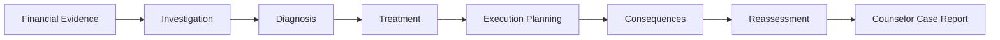

# 🩺 MEDIFIN — Inside the Mind of a Counselor

> **A scenario-based financial counseling simulation for Finance and Banking students.**

MEDIFIN puts players in the role of a **Junior Financial Counselor** who investigates financial evidence, diagnoses a company's primary financial problem, recommends treatment, observes consequences, and reassesses decisions.

**Investigate → Diagnose → Treat → Execute → Observe → Reassess → Learn**

---

## 1. Project Overview

### Case #01 — Toy Kingdom Inc.

The current playable case is inspired by the historical Toys “R” Us case. Toy Kingdom faces competitive pressure, liquidity constraints, reinvestment needs, high leverage, refinancing risks, and governance conflicts.

**Core question:** What is the company's primary financial problem, and what should be done about it?

The game follows a **13-screen / 6-phase framework**:

| Phase | Main task |
|---|---|
| 1. Client Intake & Investigation | Collect and analyze relevant financial evidence |
| 2. Diagnosis | Identify the primary financial problem |
| 3. Treatment & Execution Planning | Select treatment, timing, and stakeholder priorities |
| 4. Consequence | Observe the effects of earlier decisions |
| 5. Reassessment | Maintain or revise professional judgment |
| 6. Final Assessment | Receive the Counselor Case Report |

MEDIFIN is a **decision simulation**, not a traditional right-or-wrong quiz. Choices involve financial trade-offs and may lead to different outcomes.

---

## 2. 🎮 Play MEDIFIN

### Final Integrated Build — MEDIFIN V4

**[▶ PLAY MEDIFIN V4](https://ftu-legacy-63.github.io/G02/medifin-v4/final.html)**

**[View V4 Source Code](medifin-v4/)** · **[V4 Documentation](medifin-v4/README.md)**

> The V4 link uses the group repository's GitHub Pages path. If it does not open, check GitHub Pages deployment settings and the entry-point file `medifin-v4/final.html`.

### Development Versions

| Version | Primary development responsibility | Description | Source |
|---|---|---|---|
| V1 | Trương Vĩnh Thịnh | Independently developed initial playable prototype | [medifin-v1](medifin-v1/) |
| V2 | Lê Bảo Ngọc | Developed from V1 | [medifin-v2](medifin-v2/) |
| V3 | Trương Vĩnh Thịnh | Independently implemented frontend based on the team's UI/UX designs | [medifin-v3](medifin-v3/) |
| V4 | Lê Bảo Ngọc | Expanded game engine and integrated gameplay | [medifin-v4](medifin-v4/) |
| Final Upgrade | Trương Vĩnh Thịnh & Lê Bảo Ngọc | Collaborative technical review, refinement, and integration of the final build | [V4 integrated build](medifin-v4/) |

The final product also incorporates financial content, scenarios, and UI/UX contributions from the wider team.

---

## 3. How MEDIFIN Works

### Counselor Performance

The final report evaluates the quality of the player's decision-making process:

| Component | Weight |
|---|---:|
| Investigation | 20% |
| Diagnosis | 30% |
| Treatment | 20% |
| Execution Planning | 15% |
| Reassessment | 15% |
| **Total** | **100%** |

### Company Outcome

**Financial Resilience + Governance Stability → Final Case Outcome**

> **Decision Quality ≠ Company Outcome**

A reasonable professional decision may still result in a difficult company outcome when the business begins from a financially constrained position.

---

## 4. Financial Decision Set & Project Documents

### Financial Content

- **[MEDIFIN Final Decision Set — Markdown](MEDIFIN_Decision_Set_final.md)**
- **[MEDIFIN Final Decision Set — Excel](MEDIFIN_Decision_Set_final.xlsx)**

These documents record supporting financial content, decision alternatives, and scoring-related materials.

### Development Documentation

| Stage | Focus | Folder |
|---|---|---|
| Week 1 | Problem definition and initial concept | [WEEK 1](WEEK%201/) |
| Week 2 | Product proposal and solution structure | [WEEK 2](WEEK%202/) |
| Week 3 | Information requirements and financial evidence | [WEEK 3](WEEK%203/) |
| Week 4 | Decision logic, scoring, and midterm review | [WEEK 4](WEEK%204/) |
| Week 5 | User flow, features, and interface refinement | [WEEK 5](WEEK%205/) |
| Week 6 | Integration, testing, debugging, and scope freeze | [WEEK 6](WEEK%206/) |

The weekly materials document the progression from project concept to a playable, testable MVP.

---

## 5. UI/UX & Interactive Prototype

- 🎨 **[MEDIFIN UI/UX Draft — Canva](https://www.canva.com/design/DAHUrjuo2iU/TwEgLcpHq5jNEXqZxAyq5Q/edit?ui=eyJBIjp7fX0)**
- 🖥️ **[MEDIFIN Interactive Prototype — Figma](https://www.figma.com/proto/VtlhknTup0qQw5TX7OhloF/Medifin?node-id=1-14&p=f&t=Q6iSnSJUCTCF9sF1-0&scaling=min-zoom&content-scaling=fixed&page-id=1%3A8&starting-point-node-id=1%3A14)**

Visual concepts were translated into functional frontend components and refined through iterative implementation and testing.

---

## 6. Team Members & Responsibilities

**Group 02 — Foreign Trade University**

| Team member | Student ID | Primary responsibility |
|---|---|---|
| Nguyễn Phương Khuê | 2413380023 | Project Coordinator & Scenario Designer |
| Trương Vĩnh Thịnh | 2412380046 | Frontend & Integration Developer |
| Lâm Diệu Anh | 2413380007 | Financial Content Lead |
| Bùi Lê Trà Giang | 2413380015 | UI/UX Designer & Dialogue Writer |
| Lê Bảo Ngọc | 2412380033 | Game Engine & Logic Developer |

MEDIFIN is the result of interdisciplinary collaboration across finance, scenario design, UI/UX, frontend development, and game-engine implementation.

---

## 7. Project Reports & Contribution Evidence

### Group Records

- **[MEDIFIN Group Footprint](MEDIFIN_GROUP_FOOTPRINT.md)**
- **[Member Contribution Records](MEMBER_CONTRIBUTION.md)**
- **[Midterm Verification](MIDTERM_VERIFICATION.md)**

### Individual Footprints

Individual contribution reports for Nguyễn Phương Khuê, Trương Vĩnh Thịnh, Lâm Diệu Anh, Bùi Lê Trà Giang, and Lê Bảo Ngọc are available in the repository root directory.

### Technical Evidence

Supporting materials include versioned source code, playable builds, financial documents, UI/UX designs, integration notes, testing records, and GitHub commit history. These materials help distinguish individual development work from collaborative contributions.

---

## 8. Project Status & Scope

| Item | Status |
|---|---|
| Product | MEDIFIN — Financial Clinic |
| Current case | Case #01 — Toy Kingdom Inc. |
| Product type | Scenario-based financial decision simulation |
| Core framework | 13 screens / 6 phases |
| Development versions | V1, V2, V3, V4 |
| Integrated build | MEDIFIN V4 Final Upgrade |
| Source repository | [FTU-Legacy-63/G02](https://github.com/ftu-legacy-63/G02) |

### MVP Scope

**Included:** One complete financial counseling case, investigation, diagnosis, treatment, execution planning, consequences, reassessment, counselor performance, company outcome, and final case report.

**Outside the current MVP:** Additional cases, open-ended AI chatbot, AI-generated scenarios, custom company financial uploads, real-time market data, and multiplayer features.

The objective is to deliver **one coherent, financially explainable, and playable case** before expanding the product.

---

**MEDIFIN — Learn Finance Through Decisions, Consequences, and Reflection.**
